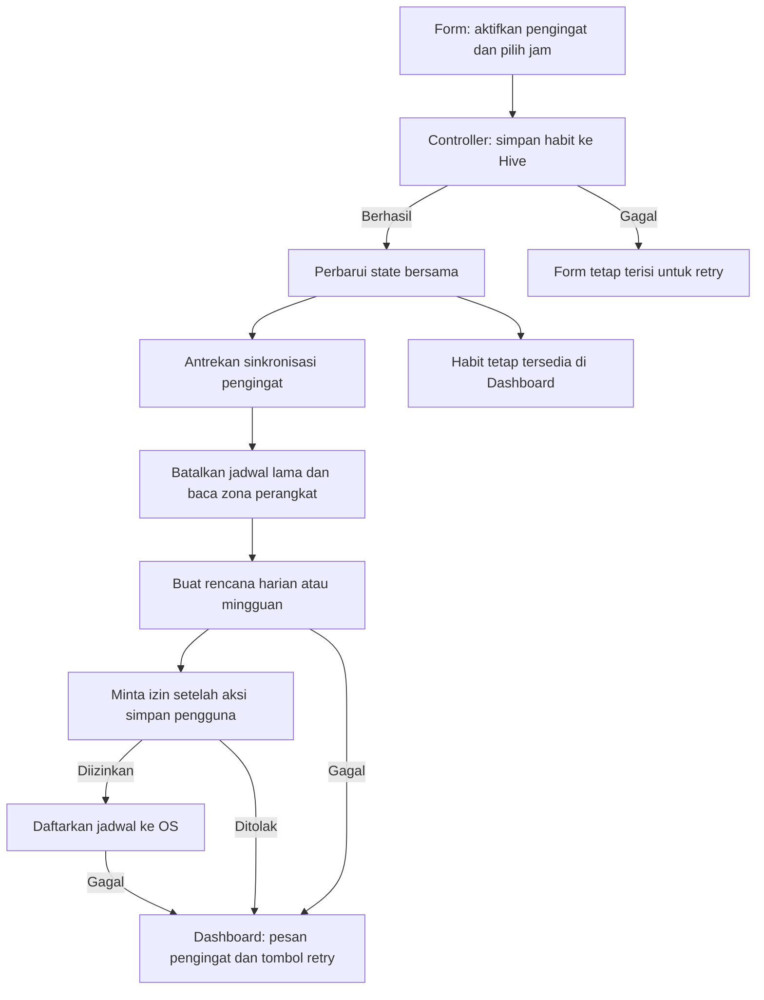
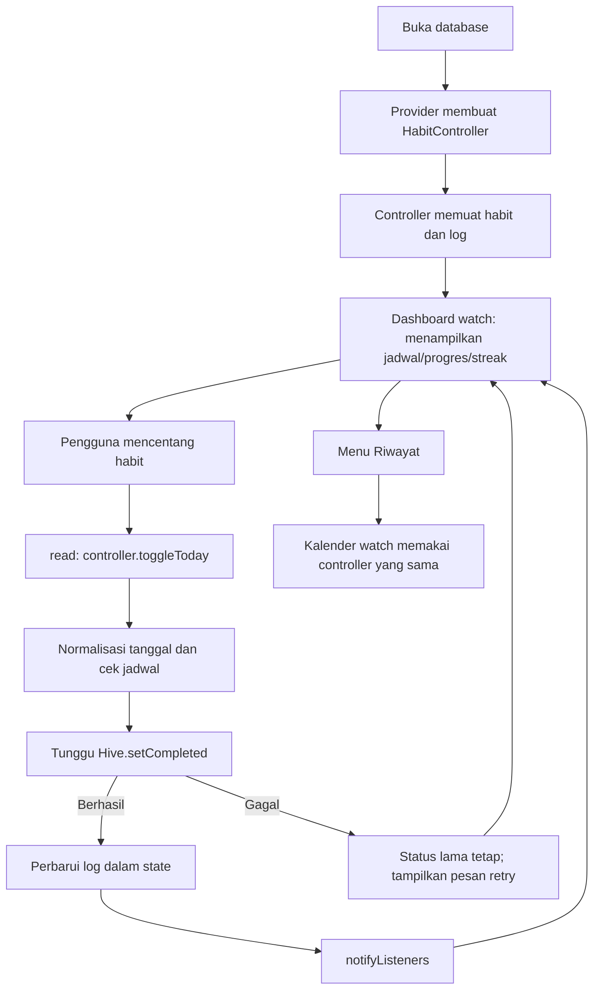

# Routine Craft — Habit Tracker

Proyek belajar Flutter berdasarkan [prd.md](prd.md), dibuat langsung di folder
ini. Phase 1–4 sudah diterapkan: UI, database/CRUD, Provider/streak,
pengingat lokal, animasi, dan statistik. Flutter **3.35.7** melalui FVM.

## Perilaku aplikasi

- Dashboard memuat habit dan riwayat centang dari Hive; instalasi baru tetap kosong.
- Tambah/edit menyimpan nama, deskripsi, ikon, warna, frekuensi, dan jam pengingat.
- Centang mencatat penyelesaian **hari ini**. Centang lagi membatalkannya.
- Satu habit memiliki paling banyak satu catatan per tanggal lokal.
- Progres hari ini hanya menghitung habit yang dijadwalkan pada hari tersebut.
- Semua habit tetap ditampilkan agar habit di luar jadwal bisa diedit/dihapus.
- Streak pada kartu dihitung dari riwayat, bukan angka contoh atau counter manual.
- Menu **Riwayat** membuka kalender bulanan. Panah berpindah dari bulan pembuatan
  habit sampai bulan saat ini. Kalender menampilkan data; tidak melakukan backfill.
- Hapus dengan konfirmasi menghapus habit dan seluruh riwayatnya.
- Kegagalan penulisan tidak mengubah status di UI. Isian form tetap ada untuk retry.
- Pergantian tanggal diperiksa saat tengah malam, app kembali aktif, dan sebelum
  pengguna mencentang. Riwayat kemarin tetap disimpan.
- Pengingat mengikuti jam, frekuensi, dan zona waktu perangkat. Edit, menonaktifkan
  pengingat, atau hapus habit memperbarui jadwal notifikasi.
- Setelah penulisan centang berhasil, kartu beranimasi dan ikon berubah menjadi
  tanda selesai. Pengaturan aksesibilitas untuk mengurangi animasi dihormati.
- Tombol **Statistik** di AppBar membuka grafik dan ringkasan **7/30 hari terakhir**.

Data disimpan offline pada perangkat, belum disinkronkan ke server.
Uninstall atau menghapus data aplikasi dapat menghapus database lokal.

## Menjalankan proyek

```sh
fvm use 3.35.7
fvm flutter pub get
fvm flutter devices
fvm flutter run -d <device-id>
```

Nyalakan emulator/simulator atau hubungkan HP. Ganti `<device-id>` dengan ID
perangkat dari `devices`. VS Code memakai `.fvm/flutter_sdk`; pilih perangkat
lalu F5. Jika terminal belum mengenali `fvm`, gunakan `/Users/sanzskuy/fvm/bin/fvm`.
Setelah penambahan plugin phase 4, hentikan aplikasi lalu jalankan ulang untuk
memuat plugin native yang baru; hot reload saja tidak cukup.

```sh
fvm dart format lib test
fvm flutter analyze
fvm flutter test --reporter expanded
fvm flutter build ios --simulator --debug
```

## Struktur dan tanggung jawab

```text
lib/
├── main.dart                    # Titik masuk: runApp()
├── app.dart                     # Buka database, Provider di atas Navigator
├── theme/app_theme.dart         # Tema bersama
├── models/
│   ├── habit.dart               # Model habit + serialisasi
│   └── habit_log.dart           # Riwayat per habit/tanggal + serialisasi
├── controllers/
│   └── habit_controller.dart    # State, CRUD, centang, progres, rollover tanggal
├── services/
│   ├── habit_service.dart       # Kontrak penyimpanan habit dan log
│   ├── hive_habit_service.dart  # Implementasi penyimpanan Hive
│   ├── habit_streak.dart        # Aturan jadwal dan streak, murni Dart
│   ├── habit_statistics.dart    # Agregasi log menjadi progres harian/periode
│   ├── reminder_service.dart    # Kontrak pengingat + no-op untuk tes
│   ├── reminder_plan.dart       # Tanggal berikutnya dan slot harian/mingguan
│   └── local_reminder_service.dart # Rekonsiliasi + adapter plugin Android/iOS
├── utils/habit_date.dart        # Normalisasi tanggal lokal dan key YYYY-MM-DD
└── views/
    ├── dashboard_view.dart      # Menampilkan state + aksi harian/menu CRUD
    ├── add_habit_view.dart      # Input lokal form tambah/edit
    ├── habit_history_view.dart  # Kalender bulanan
    ├── habit_statistics_view.dart # Grafik fl_chart + pilihan periode
    └── widgets/
        ├── habit_card.dart      # Kartu bersama, streak dan footer opsional
        └── habit_appearance.dart # Pilihan ikon/warna
```

## Belajar phase 4: pengingat, animasi, dan grafik

Pengingat memakai [flutter_local_notifications 19.5.0](https://pub.dev/packages/flutter_local_notifications/versions/19.5.0),
[flutter_timezone](https://pub.dev/packages/flutter_timezone), dan
[timezone](https://pub.dev/packages/timezone). Grafik memakai
[fl_chart](https://pub.dev/packages/fl_chart); versi yang terpasang dicatat di `pubspec.lock`.

Flow pengingat:



`ReminderPlan.build()` memisahkan perhitungan dari platform: setiap hari memakai
satu notifikasi berulang; Senin–Jumat memakai lima notifikasi mingguan; akhir pekan
memakai dua. Jam yang sudah lewat dijadwalkan pada kesempatan berikutnya.
Tanggal dibuat dengan konstruktor kalender agar perubahan DST tidak menggeser
jam lokal yang dipilih. `PluginReminderBackend` menerjemahkan rencana menjadi
`zonedSchedule()` dengan pengulangan `time` atau `dayOfWeekAndTime`.

`HabitController._syncReminders()` menjalankan operasi secara berurutan.
Saat giliran berjalan, ia membaca daftar habit terbaru. Ini mencegah operasi
resume yang bersamaan dengan edit/hapus meninggalkan jadwal dari data lama.
Startup, tengah malam, dan resume melakukan sinkronisasi **tanpa meminta izin**;
simpan habit dengan pengingat dan tombol retry adalah aksi yang meminta izin.
Saat membuka kembali app, reminder dari habit phase 2/3 juga dipulihkan.

Jadwal dihitung ulang dari data Hive dan semua pending reminder dibangun ulang.
ID berupa nomor urut unik pada rencana yang diurutkan menurut ID habit; tidak
bergantung pada `hashCode`. Tidak perlu mengubah model atau format database lama.
Jika sebagian penjadwalan gagal, jadwal parsial dibatalkan dan pesan retry muncul.
Kegagalan pengingat tidak membatalkan penyimpanan habit. Jadwal berulang tetap
berjalan sampai pengingat dinonaktifkan atau habit dihapus, termasuk jika habit
hari itu sudah dicentang. Menekan notifikasi membuka aplikasi; jika sebelumnya
tertutup, halaman awalnya adalah Dashboard.

Konfigurasi native mengikuti dokumentasi plugin: Android memakai permission
notifikasi, receiver untuk alarm/reboot, desugaring Java, dan ikon monokrom
`ic_notification` yang dipertahankan saat release. iOS memakai delegate
`UNUserNotificationCenter` dengan permintaan izin otomatis saat startup dimatikan.

Batas yang perlu dipahami saat mencoba:

- Android memakai `inexactAllowWhileIdle`: pengingat dijadwalkan sekitar jam pilihan
  dan **dapat terlambat**, bergantung penghemat daya/OS. Tidak meminta izin alarm presisi.
- Jika izin ditolak, buka pengaturan notifikasi aplikasi pada perangkat, kembali ke
  app, atau tekan **Izinkan / coba lagi**. Data habit tetap tersedia.
- Aplikasi membatasi total menjadi **64 slot jadwal** agar sesuai batas iOS yang
  dijelaskan dokumentasi plugin. Contoh: 12 habit Senin–Jumat = 60 slot. Melebihi
  batas menonaktifkan penjadwalan sampai pengguna mengurangi slot lalu retry.
- Perubahan zona waktu disinkronkan ketika app kembali aktif. Uji notifikasi dengan
  mode fokus/pengaturan suara perangkat yang sesuai.

Flow animasi dan statistik:

1. Checkbox → `controller.toggleToday()` → tunggu Hive → log berubah → `notifyListeners()`.
2. Dashboard meneruskan `isCompleted` ke `HabitCard`. `AnimatedContainer` mengubah
   warna/border, sedangkan `AnimatedSwitcher` mengganti ikon dengan transisi skala.
   Durasi menjadi nol jika perangkat mengaktifkan pengurangan animasi.
3. Halaman statistik memakai `context.watch<HabitController>()`, sehingga memakai
   habit/log yang sama dengan Dashboard dan kalender.
4. `HabitStatistics.calculate()` membuat satu `DailyProgress` per tanggal; hanya
   jadwal yang sesuai frekuensi dan sejak tanggal habit dibuat yang dihitung.
5. `BarChart` menampilkan persentase harian. Ketuk batang untuk melihat jumlah;
   **Rincian harian** menyediakan versi teks yang dapat dibaca screen reader.
6. Pilihan 7/30 hari hanya mengubah state lokal halaman (`setState`), tanpa menulis
   database. Periode berakhir pada hari ini, bukan minggu/bulan kalender penuh.

Rumus periode: `total centang valid / total jadwal × 100`, bukan rata-rata persen
harian. Contoh: 1/1 kemarin dan 1/2 hari ini → 2/3 = 67%. Log duplikat, habit yang
sudah dihapus, tanggal di luar periode, serta centang di luar jadwal diabaikan.
Hari tanpa jadwal tidak menambah pembagi; periode kosong menampilkan **—**.
Edit frekuensi menghitung ulang statistik dari jadwal terbaru tanpa menghapus log.

Urutan belajar phase 4: `reminder_plan.dart` → `local_reminder_service.dart` →
`HabitController._syncReminders()` → `habit_card.dart` → `habit_statistics.dart` →
`habit_statistics_view.dart`. Tes memakai backend palsu dan mock platform channel
agar izin/notifikasi OS tidak benar-benar muncul saat `flutter test`.

## Belajar Provider pada phase 3

Menggunakan [provider](https://pub.dev/packages/provider) dengan `ChangeNotifier`.
`HabitController` memegang daftar habit, log, tanggal hari ini, status loading,
dan status penulisan. Widget tidak membaca Hive secara langsung.

- `ChangeNotifierProvider(create: ...)` membuat controller dan mengelola dispose.
- Provider ditempatkan **di atas MaterialApp/Navigator** supaya Dashboard,
  form tambah/edit, serta kalender memakai instance controller yang sama.
- `context.watch<HabitController>()` pada Dashboard/kalender mendengarkan perubahan.
- `context.read<HabitController>()` pada callback tombol mengirim perintah tanpa
  membuat callback menjadi listener.
- Sesudah penyimpanan berhasil, controller mengubah state dan memanggil
  `notifyListeners()`; widget yang memakai `watch` membangun ulang tampilan.
- `setState()` tetap dipakai untuk input sementara form dan bulan kalender.
  Input tersebut hanya diperlukan oleh satu halaman.

Berbeda dari phase 2, Dashboard sekarang `StatelessWidget` dan tidak memuat ulang
seluruh database setelah setiap simpan. Controller memperbarui state bersama
setelah `await` berhasil. Loading dan retry awal membaca database; selama ada
penulisan, aksi berikutnya ditahan untuk mencegah operasi ganda/bersamaan.

## Flow pencatatan harian



Flow tambah/edit juga melalui controller: validasi form → `createHabit` atau
`updateHabit` → tunggu Hive → perbarui state → kembali ke Dashboard. Hapus
meminta konfirmasi sebelum controller menghapus habit dan log dalam satu batch.

## Aturan tanggal dan streak

Tanggal mengikuti **zona waktu lokal perangkat**. `HabitDate.day()` membuang
komponen jam; key penyimpanan berbentuk `YYYY-MM-DD`. Hari sebelumnya dibuat
lewat konstruktor kalender, bukan selisih 24 jam, agar aman terhadap perubahan DST.

Aturan streak:

1. Setiap hari: hari kalender berurutan.
2. Senin–Jumat: hanya hari kerja; Sabtu/Minggu tidak memutus streak.
3. Sabtu–Minggu: hanya hari akhir pekan; Senin–Jumat tidak memutus streak.
4. Jika hari ini belum selesai, mulai menghitung dari hari terjadwal sebelumnya.
   Hari ini masih terbuka sampai hari berakhir.
5. Hari terjadwal yang terlewat memutus streak. Centang hari ini memulai lagi dari 1.
6. Tanggal sebelum habit dibuat, tanggal mendatang, dan log habit lain tidak dihitung.
7. Beberapa log pada tanggal yang sama dihitung satu hari.
8. Mengubah frekuensi menghitung ulang streak memakai jadwal baru. Riwayat lama
   tetap disimpan dan terlihat pada kalender; tidak ada log yang ditulis ulang.

Contoh habit harian: selesai Rabu/Kamis, Jumat belum dicentang → streak 2.
Selesai Jumat → streak 3. Jika Sabtu terlewat, Minggu sebelum dicentang → 0.

Contoh Senin–Jumat: selesai Jumat, lalu Senin selesai → streak 2. Akhir pekan
merupakan hari di luar jadwal. Label **hari terjadwal beruntun** menyatakan aturan ini.

## Penyimpanan dan kompatibilitas phase 2

Tetap memakai box `habits_v1` dari phase 2. Format/key habit lama tetap dapat dibaca.
Tidak menghapus database, mengganti nama box, atau memasukkan data contoh.

| Record | Key | Isi Map |
| --- | --- | --- |
| Habit | UUID habit | Model dari `Habit.toMap()` |
| HabitLog | `log:<habitId>:YYYY-MM-DD` | `recordType: habit_log`, ID log, habitId, tanggal |

`getHabits()` memisahkan record habit dari log. `getLogs()` membaca record log
untuk habit yang masih ada. Key log tetap per habit/tanggal membuat penyimpanan
centang idempoten: centang berkali-kali tidak membuat duplikat. Pembatalan
menghapus key tanggal itu. `deleteAll()` menghapus habit dan log dalam box yang
sama; riwayat habit lain tetap utuh.

`toMap()` / `fromMap()` tetap memisahkan model dari database. Warna berupa int,
ikon berupa string, frekuensi memakai nama enum, jam opsional berupa `HH:mm`,
dan `createdAt` berupa ISO 8601. `HabitLog.completedAt` disimpan sebagai tanggal
kalender lokal tanpa jam.

## Urutan membaca kode

1. `habit_date.dart`: cara menghasilkan key tanggal dan hari sebelumnya.
2. `habit_streak.dart`: `isScheduled()` lalu `current()` untuk menghitung streak.
3. `habit_log.dart` dan `hive_habit_service.dart`: penyimpanan/ pembatalan centang.
4. `habit_controller.dart`: lihat `load()`, `_mutate()`, `toggleToday()`,
   `refreshDate()`, timer tengah malam, dan observer lifecycle.
5. `app.dart`: posisi Provider dan bagaimana `load()` dipanggil saat controller dibuat.
6. `dashboard_view.dart`: `watch` di build dan `read` saat checkbox ditekan.
7. `add_habit_view.dart`: input masih lokal; penyimpanan sekarang lewat controller.
8. `habit_history_view.dart`: bulan adalah state lokal, log adalah state bersama.

## Latihan

- Tambah habit harian, centang lalu batalkan, dan amati progres serta streak.
- Centang lagi, tutup aplikasi penuh, buka ulang, dan lihat kalender riwayat.
- Buat habit akhir pekan; pada hari kerja checkbox dinonaktifkan.
- Edit frekuensi dan amati perhitungan streak dengan riwayat yang tetap tersimpan.
- Baca tes weekday/weekend dan ubah data tanggalnya untuk memahami hari terlewat.
- Aktifkan pengingat beberapa menit ke depan, simpan, izinkan notifikasi, dan
  pindahkan app ke background. Android dapat menunda pengingat.
- Edit jam/frekuensi, matikan pengingat, lalu hapus habit dan pastikan jadwal lama
  tidak muncul lagi. Uji juga setelah app ditutup penuh dan setelah reboot Android.
- Centang/batalkan habit, buka Statistik, lalu ganti periode 7/30 hari.

## Verifikasi

Hasil phase 4: `flutter analyze` bersih, seluruh **72 tes lulus**, dan
`flutter build ios --simulator --debug` berhasil. Artifact berada di
`build/ios/iphonesimulator/Runner.app`.

Tes mencakup CRUD phase 2, persistensi log saat database dibuka ulang,
centang idempoten, hapus beserta log, kegagalan penyimpanan, pembatalan,
aturan streak, pergantian bulan/tahun, tengah malam otomatis, app resume,
kalender, serta tampilan lebar 320/800 dengan teks diperbesar. Tambahan phase 4:
agregasi statistik, periode kosong, jadwal per frekuensi, batas 64 slot, izin
ditolak/retry, kegagalan penjadwalan parsial, perubahan zona waktu/DST, antrean
resume/edit, dan pemanggilan API native Android/iOS melalui mock platform channel.

Percobaan build Android phase 4 gagal pada Java **25.0.3** / Gradle **8.12**
(`What went wrong: 25.0.3`). Gunakan JDK 17 yang kompatibel dengan Gradle proyek;
rujukan: [matriks kompatibilitas Gradle](https://docs.gradle.org/current/userguide/compatibility.html).
Setelah JDK tersedia, arahkan Flutter ke path JDK tersebut dan periksa toolchain:

```sh
fvm flutter config --jdk-dir="<path-ke-jdk-17>"
fvm flutter doctor -v
fvm flutter build apk --debug
```

Sebagian lisensi SDK Android sebelumnya belum diterima. Jika masih muncul pada
`doctor`, jalankan `fvm flutter doctor --android-licenses`, baca, dan tentukan
persetujuannya sebelum build. Konfigurasi JDK global/lisensi tidak diubah oleh
implementasi phase 4.

Simulator iPhone SE iOS 17.2 sebelumnya gagal boot karena `launchd_sim` tidak
merespons. Build iOS berhasil, tetapi **kemunculan notifikasi, persistensi setelah
app killed, dan reschedule setelah reboot tetap perlu diuji pada perangkat**.
Tes database dan mock platform channel tidak menggantikan pengujian runtime
pada HP. Karena itu, checklist runtime pada Definition of Done PRD tetap terbuka.
