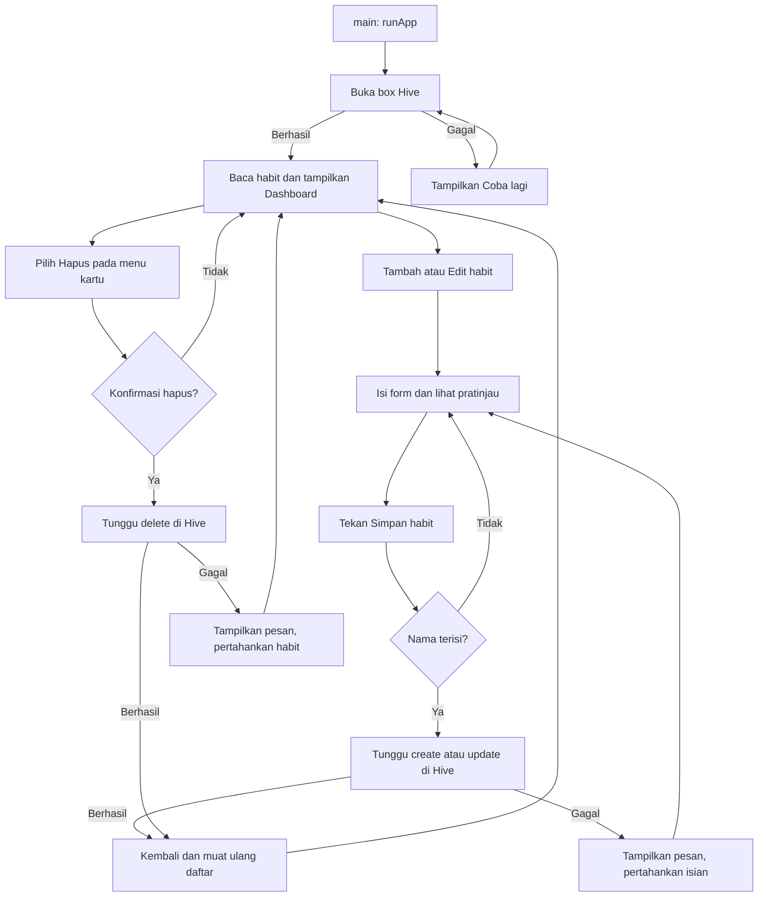

# Routine Craft — Habit Tracker

Proyek belajar Flutter berdasarkan [prd.md](prd.md), dibuat langsung di folder
ini. Phase 1 (setup/UI) dan phase 2 (database lokal/CRUD habit) sudah diterapkan.
Flutter **3.35.7** dipin melalui FVM.

## Perilaku aplikasi pada phase 2

- Saat dibuka, aplikasi membuka database Hive dan menampilkan habit tersimpan.
- Instalasi baru mulai dengan daftar kosong, tanpa memasukkan habit contoh.
- **Tambah habit** membuka form nama, deskripsi, ikon, warna, frekuensi, dan jam.
- **Simpan habit** memvalidasi nama lalu menyimpan data di perangkat.
- Menu pada kartu menyediakan **Edit** dan **Hapus**. Hapus meminta konfirmasi.
- Edit memakai form yang sama dengan isian lama. ID dan tanggal pembuatan tetap.
- Setelah tambah/edit/hapus berhasil, Dashboard membaca ulang database.
- Jika penyimpanan gagal, form tetap terbuka dengan isian yang sudah diisi.
- Tombol simpan dan navigasi kembali ditahan selama penulisan berlangsung agar
  satu aksi tidak menghasilkan beberapa habit.
- Ringkasan Dashboard menampilkan jumlah habit dan jumlah jam pengingat tersimpan.

Jam pengingat baru dicatat, belum menjadwalkan notifikasi. Penyelesaian harian,
riwayat `HabitLog`, filter habit berdasarkan hari, dan perhitungan streak masuk
phase 3; notifikasi dan grafik masuk phase 4. Data habit disimpan offline di
perangkat dan belum disinkronkan ke server. Menghapus data aplikasi atau
uninstall dapat menghapus database lokal.

## Menjalankan proyek

Dari folder proyek:

```sh
fvm use 3.35.7
fvm flutter pub get
fvm flutter devices
fvm flutter run -d <device-id>
```

Nyalakan emulator/simulator atau hubungkan HP. Ganti `<device-id>` dengan ID
perangkat dari perintah `devices`. VS Code sudah memakai `.fvm/flutter_sdk`;
pilih perangkat lalu tekan F5. Jika terminal belum mengenali `fvm`, gunakan
`/Users/sanzskuy/fvm/bin/fvm`.

Setelah menambah package pada phase 2, hentikan aplikasi yang masih berjalan
lalu jalankan ulang agar plugin direktori penyimpanan ikut terdaftar.

```sh
fvm dart format lib test
fvm flutter analyze
fvm flutter test --reporter expanded
fvm flutter build ios --simulator --debug
```

## Struktur dan tanggung jawab

```text
lib/
├── main.dart                    # Titik masuk: runApp()
├── app.dart                     # MaterialApp, membuka database, loading/retry
├── theme/app_theme.dart         # Tema Material 3
├── models/
│   ├── habit.dart               # Model, enum frekuensi, toMap/fromMap
│   └── habit_log.dart           # Model riwayat untuk phase 3
├── views/
│   ├── dashboard_view.dart      # Memuat daftar + menu edit/hapus
│   ├── add_habit_view.dart      # Form tambah/edit + pratinjau + simpan
│   └── widgets/
│       ├── habit_card.dart      # Kartu habit bersama
│       └── habit_appearance.dart # Pilihan ikon dan warna
├── controllers/                # Disiapkan untuk phase 3
└── services/
    ├── habit_service.dart       # Kontrak CRUD
    └── hive_habit_service.dart  # Implementasi CRUD dengan Hive
```

Sumber data contoh phase 1 sudah diganti dengan database. `HabitLog` belum
digunakan. `Habit` mengikuti model PRD dengan tambahan `frequency` untuk
pilihan frekuensi pada form.

## Cara penyimpanan bekerja

Paket yang dipakai adalah [hive](https://pub.dev/packages/hive),
[hive_flutter](https://pub.dev/packages/hive_flutter), dan
[uuid](https://pub.dev/packages/uuid). Tidak memakai `build_runner`.

`Hive.initFlutter()` menentukan direktori dokumen aplikasi. Kemudian
`Hive.openBox<Map>('habits_v1')` membuka **box**: wadah pasangan key/value.
Key adalah ID unik habit (UUID); value adalah `Map` berisi seluruh field habit.
Box yang sama dibuka pada peluncuran berikutnya. Akhiran `_v1` menandai versi
penyimpanan awal; perubahan format kelak perlu strategi migrasi data.

`Habit.toMap()` mengubah object Dart menjadi data yang didukung Hive:

- `colorHex`: angka, bukan object `Color`.
- `iconKey`: string, bukan object `IconData`.
- `frequency`: nama enum (`daily`, `weekdays`, `weekends`), bukan posisi enum.
- `reminderTime`: string `HH:mm` atau `null`.
- `createdAt`: string ISO 8601, dikembalikan menjadi `DateTime` saat dibaca.

`Habit.fromMap()` melakukan kebalikannya. Model tetap bebas dari import Hive
atau Flutter. Field frekuensi yang belum ada dibaca sebagai `daily`.

| Operasi | Method service | Operasi Hive |
| --- | --- | --- |
| Create | `createHabit(habit)` | `put(id, habit.toMap())`, menolak ID duplikat |
| Read | `getHabits()` | Membaca `box.values`, mengubah Map ke Habit, mengurutkan yang terbaru |
| Update | `updateHabit(habit)` | `put` dengan ID yang sama, menolak ID yang tidak ditemukan |
| Delete | `deleteHabit(id)` | `delete(id)`, menolak ID yang tidak ditemukan |

Penulisan selalu di-`await`. UI baru menampilkan keberhasilan setelah operasi
penyimpanan selesai. Service tidak memanggil `setState()` atau navigasi.
`HabitService` adalah interface: widget cukup mengetahui kontrak CRUD,
sementara detail Hive berada di `HiveHabitService`.

## Flow aplikasi



## Urutan membaca kode untuk belajar

1. Buka `habit.dart`: lihat bagaimana model dikonversi ke/dari `Map`.
2. Buka `habit_service.dart`: empat operasi CRUD ditulis sebagai kontrak.
3. Buka `hive_habit_service.dart`: lihat `open()`, `put()`, `values`, dan `delete()`.
4. Buka `app.dart`: `FutureBuilder` menunggu database siap sebelum Dashboard
   tampil. Ada tampilan loading serta retry jika pembukaan gagal.
5. Buka `_loadHabits()` di `dashboard_view.dart`: `await` membaca database,
   lalu `setState()` memperbarui daftar. Data baru disusun oleh `ListView.builder`.
6. Buka `initState()` di `add_habit_view.dart`: mode tambah membuat ID/tanggal
   baru; mode edit mengisi controller dan pilihan dari habit yang sudah ada.
7. Ikuti `_saveHabit()`: validasi → bentuk object → tunggu CRUD →
   `Navigator.pop(habit)`. Dashboard menunggu hasil `Navigator.push<Habit>()`
   lalu memuat ulang daftar.
8. Ikuti `_deleteHabit()`: konfirmasi → tunggu hapus → muat ulang daftar.

`setState()` memperbarui tampilan di memori. Hive menyimpan data supaya dapat
dibaca lagi setelah aplikasi dibuka kembali. Saat ini state dikelola per
halaman; Provider/Riverpod dan logic streak diperkenalkan pada phase 3.

## Latihan phase 2

1. Tambah habit, ubah ikon/warna/jam, lalu simpan.
2. Tutup aplikasi sepenuhnya dan buka lagi; periksa apakah field tetap sama.
3. Edit habit, matikan jam pengingat, dan simpan; lihat perubahan ringkasannya.
4. Pilih hapus lalu **Batal**. Ulangi dengan **Hapus** dan buka ulang aplikasi.
5. Baca tes persistensi dan bandingkan `close()`/`open()` dengan alur peluncuran app.

## Verifikasi

Hasil phase 2: analisis kode bersih, seluruh 22 tes lulus, dan build iOS
simulator berhasil (`build/ios/iphonesimulator/Runner.app`).

`test/hive_habit_service_test.dart` memakai Hive sungguhan di folder sementara.
Tes menutup lalu membuka ulang database untuk memeriksa tambah, edit, hapus,
seluruh field, urutan daftar, serta penolakan perubahan yang tidak valid.

`test/widget_test.dart` memakai service pengganti untuk mengontrol kegagalan
baca/simpan/hapus dan penundaan penulisan. Tes meliputi CRUD, pembatalan,
validasi, pratinjau, pengingat, serta layout lebar 320/800 dengan skala teks 1,5.

Kondisi toolchain dari phase 1: Android memakai Java 25 yang belum cocok
untuk Gradle 8.12 bawaan, dan sebagian lisensi SDK belum diterima. Simulator
iPhone SE iOS 17.2 juga sebelumnya gagal boot karena `launchd_sim` tidak
merespons. Hasil tes database tidak menggantikan pengujian runtime di HP.
